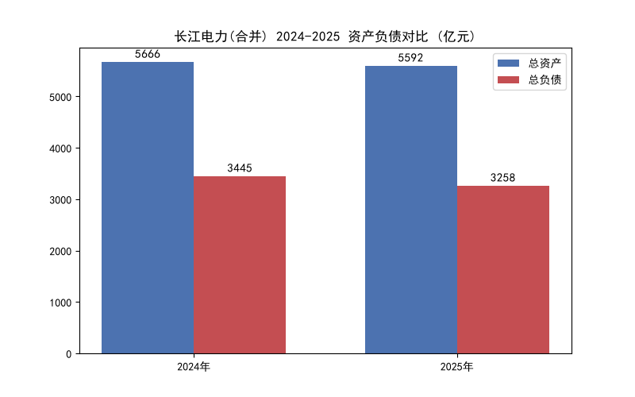

# 长江电力 (Yangtze Power) 2025 财务数据分析

本项目基于中国长江电力股份有限公司（600900.SH）2025年财报，使用 Python 对“合并报表”与“母公司报表”进行深度拆解与可视化分析。

## 📁 项目结构
```text
├── data/                  # 财报原始数据 (Excel格式)
│   ├── consolidated/      # 合并报表数据 (资产负债表/利润表/现金流量表)
│   └── parent/            # 母公司报表数据 (资产负债表/利润表/现金流量表)
├── notebooks/             # Jupyter 数据分析代码
│   ├── consolidated_analysis.ipynb  # 合并报表分析
│   └── parent_analysis.ipynb        # 母公司报表分析
├── outputs/               # 生成的图表图片
└──china_yangtze_power_2025_financial_report.pdf   #长江电力2025年财报
└── README.md
```
📊 数据来源

原始财报：项目根目录下的"china_yangtze_power_2025_financial_report.pdf"

官方链接：https://static.sse.com.cn/disclosure/listedinfo/announcement/c/new/2026-04-30/600900_20260430_WC8R.pdf

🔍 核心分析结论

财务结构稳健：2025年合并报表资产负债率为 58.27%（较2024年的 60.80% 有所下降），表明公司在保持庞大资产规模的同时，财务杠杆正在优化。

极强的盈利能力：合并报表营业总收入 862.42 亿元，净利润 349.49 亿元，净利率高达 40.52%，体现了大水电资产极高的商业护城河。

现金奶牛属性：经营活动现金流净额高达 605.63 亿元，净现比达到 1.73（每赚 1 元净利润，实际收回 1.73 元现金），说明公司利润含金量极高，不是“纸面富贵”。

母子公司惊人差异：母公司营业收入仅为 252.18 亿元，但净利润高达 318.96 亿元。原因是母公司通过“长期股权投资”收取了子公司（如川云公司）的巨额分红（投资收益）。

📈 可视化图表展示



💻 技术栈

语言：Python 3.14.7

库：Pandas (数据清洗与计算)、Matplotlib (数据可视化)、Openpyxl (读取 Excel)

工具：Jupyter Notebook / VS Code